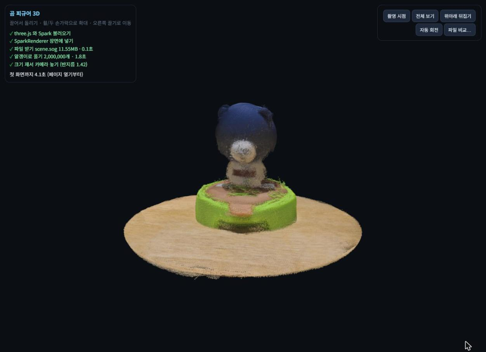
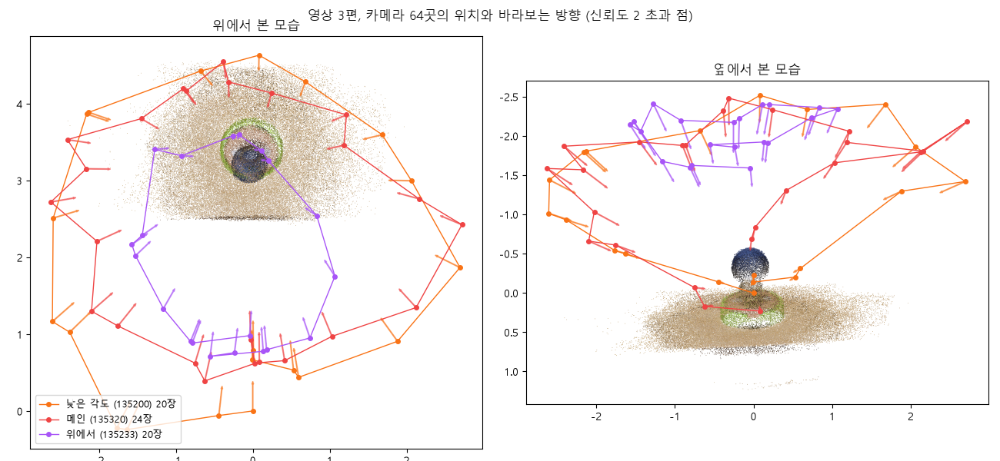
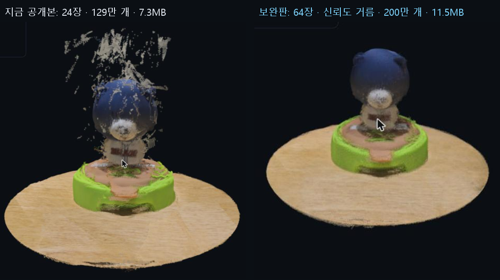
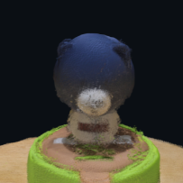

# 곰 피규어 3D — 폰 영상으로 만든 가우시안 스플랫 뷰어

탁자 위 야구 곰 피규어를 폰으로 돌며 찍고, MapAnything으로 점을 얻어 가우시안 스플랫으로 바꾼 뒤 웹에 올렸습니다. 1차(영상 1편, 24장)를 공개한 뒤, 영상 3편 64장과 신뢰도 거름으로 보완한 2차를 지금 공개하고 있습니다.

- **보기:** https://basco-git.github.io/open-space/
- **장면 파일:** https://basco-git.github.io/open-space/scene.sog



## 1. 공개 판단

**집 탁자 위 피규어 하나와 탁자 면만 남긴 장면이라 공개해도 됩니다.** 사람 얼굴, 문패, 모니터, 차량 번호는 영상에 처음부터 없습니다. 영상 배경에는 집 안 벽, 바닥, 강아지, 액자 모서리, 슬리퍼가 보였지만, 피규어 둘레 반경 1.0(모델 단위) 밖을 잘라 내 공개 파일에는 남지 않았습니다. 원본 영상과 추출한 사진은 이 저장소에 올리지 않았습니다.

## 2. 촬영

같은 피규어를 영상 4편으로 찍었고, 그중 3편을 썼습니다. 모두 1080×2320(세로), 30fps입니다.

| 영상 | 길이 | 경로 | 뽑은 장수 | 선명도(라플라시안 분산) 최소 |
|---|---|---|---:|---:|
| `20261113_135320.mp4` (메인) | 30.4초 | 탁자보다 조금 높은 곳에서 한 바퀴 | 24 | 73.2 |
| `20261113_135200.mp4` (낮은 각도) | 21.9초 | 탁자 높이에 가깝게 한 바퀴 | 20 | 85.0 |
| `20261113_135233.mp4` (위에서) | 19.2초 | 위에서 내려다보며 한 바퀴 (8~9초 흔들림) | 20 | 57.1 |

각 영상을 장수만큼 구간으로 나누고, 구간마다 가장 선명한 장을 골랐습니다. 그래서 흔들린 구간에서도 그나마 덜 흐린 장이 뽑혔습니다. 모델 입력 크기는 518×252입니다(모델이 비율에 맞춰 줄임).

## 3. 복원 (코랩 T4, Colab MCP로 실행)

| 항목 | 1차 (24장) | **2차 (64장, 공개)** |
|---|---:|---:|
| 복원 시간 | 9.4초 | **27.3초** |
| 최대 GPU 메모리 | 6.49GB | **9.06GB** |
| 점 개수 (튄 점 0.5% 제거 후) | 2,587,393 | **7,017,683** |
| 카메라 퍼짐 비 (카메라 상자 대각선 ÷ 장면 상자 대각선) | 7.737 ÷ 6.406 = 1.21 | **7.738 ÷ 6.261 = 1.24** |

GPU는 Tesla T4(15.6GB, 계산 능력 7.5)라 `amp_dtype="fp16"`으로 돌렸습니다. 모델 `facebook/map-anything-apache`는 처음 받을 때 189초, 같은 서버에서 캐시가 남은 두 번째는 53초가 걸렸습니다.

### 실제 촬영 경로와 비교



- **위에서 본 그림:** 영상 세 편이 각각 피규어를 둘러싼 고리가 되고, 화살표(바라보는 방향)가 모두 가운데를 향합니다. 실제로 세 번 둘레를 돈 것과 같습니다.
- **카메라 높이:** 대상까지 평균 거리와 높이가 촬영 방식과 맞게 갈렸습니다.
  - 낮은 각도: 거리 3.05, 높이 1.15
  - 메인: 거리 2.74, 높이 1.42
  - 위에서: 거리 2.78, 높이 2.06 (가장 높고 고리도 가장 작음)
- **퍼짐 비 1.24:** 기준인 0.1보다 훨씬 커서, 제자리에서 돈 것이 아니라 걸으며 찍은 것으로 나옵니다.
- **크기 단위:** 모델은 미터 단위로 추정하지만, 손바닥만 한 피규어가 높이 약 1, 카메라 고리 폭이 약 5.7로 나왔습니다. 절대 크기는 믿을 수 없고, 비율만 의미가 있습니다.

## 4. 알갱이 만들기와 정리

| 단계 | 설정 | 알갱이 수 |
|---|---|---:|
| 복원 점 | | 7,017,683 |
| 신뢰도 거르기 | 모델이 준 점별 신뢰도 **2 이하 제거** (전체의 약 29%) | 5,010,731 |
| 대상 둘레 자르기 | 64대 카메라 시선이 가장 가깝게 모이는 점(최소제곱)을 중심으로 **반경 1.0** | 3,813,925 |
| 탁자 수평 맞추기 | RANSAC으로 탁자 평면을 찾아 **19.9°** 기울기를 바로잡음 | — |
| 개수 줄이기 | 고르게 **200만 개** 뽑기 (`--n-keep 2000000`) | **2,000,000** |
| 점 → 알갱이 | 반지름 = K × 긴 변 ÷ √N, **K = 1.4** → 0.00185, 불투명도 0.9, 회전 없음, `f_rest` 없음 | 2,000,000 |

신뢰도는 1.0 근처(최저)에 전체 점의 약 4분의 1이 몰려 있었습니다. 이 점만 따로 그려 보니 머리 위 허공 줄무늬와 탁자 아래 잡티였습니다. 2를 넘는 점만 남기면 피규어와 탁자만 깨끗하게 남습니다. 1차에서 손으로 정한 높이·반경 기준으로 지우던 일을 모델의 신뢰도가 대신했습니다.

381만 개(SOG 21.5MB)로도 만들어 비교했습니다. 같은 시점에서 눈으로는 200만 개 판과 차이가 없었고, PC 첫 화면이 8.5초 대 4.7초였습니다. 그래서 200만 개를 공개했습니다.

```bash
uv run --python 3.13 --with numpy --with matplotlib python tools/build.py \
  --npz points_multi.npz --conf-min 2 --crop 1.0 --level --n-keep 2000000
```

### 1차와 비교



| | 1차 | 2차 (공개) |
|---|---|---|
| 프레임 | 메인 영상 24장 | 영상 3편 64장 |
| 허공 점 정리 | 반경·높이 손 기준 (113,148개 제거) | 모델 신뢰도 2 이하 제거 |
| 알갱이 | 1,294,954 | 2,000,000 |
| SOG | 7.28MB | 11.55MB |
| 머리 위 줄무늬 | 남음 | **거의 없음** |
| 정수리·받침대 뒤쪽 | 성김 | **채워짐** (위·낮은 각도 영상 덕분) |
| 유니폼 글자 "BEARS" | 읽힘 | **조금 더 흐려짐** (7절 참고) |

## 5. 형식별 비교 (공개 장면, 알갱이 2,000,000개)

변환 도구는 `npx -y @playcanvas/splat-transform@3.10.3 -w` (Windows 11 노트북 CPU)입니다. 크기는 바이트 수이고, MB는 1,000,000으로 나눈 값입니다. "뷰어에서 풀기"는 이 페이지에 파일을 끌어다 놓았을 때 알갱이로 풀리기까지 걸린 시간입니다.

| 형식 | 크기(바이트) | MB | 변환(초) | 알갱이 | 알갱이당 바이트 | PLY 대비 | 뷰어에서 풀기(초) |
|---|---:|---:|---:|---:|---:|---:|---:|
| `.ply` (원본) | 136,000,417 | 136.00 | 1.1 (저장) | 2,000,000 | **68.0** | 1배 | 3.05 |
| `.compressed.ply` | 32,563,197 | 32.56 | 14.2 | 2,000,000 | 16.28 | 4.2배 | 2.16 |
| `.spz` | 13,883,715 | 13.88 | 20.2 | 2,000,000 | 6.94 | 9.8배 | 4.70 |
| **`.sog`** (공개) | **11,545,945** | **11.55** | 19.0 | 2,000,000 | **5.77** | **11.8배** | 2.26 |

- **알갱이 수:** 네 형식 모두 같습니다. `.compressed.ply`는 헤더에서 셌고, `.sog`·`.spz`는 다시 PLY로 풀어서 셌습니다. 뷰어에서 연 값도 같습니다.
- **원본 PLY:** 알갱이당 68.0바이트로 `float 17개 × 4바이트`와 정확히 맞습니다. 헤더에 `f_rest`가 없다는 확인입니다.
- **원본 PLY 크기:** 136MB로 GitHub 한도(100MiB)를 넘어서 올릴 수 없습니다. 압축 형식이 꼭 필요한 이유입니다.
- **변환 시간:** `npx`가 시작하는 데 걸리는 몇 초가 포함된 값입니다.
- **화질:** 같은 시점(아래)에서 PLY와 SOG를 나란히 놓으면 눈으로는 차이를 찾기 어렵습니다.
- **공개 형식:** 가장 작고, Spark 2.4.0에서 열리고, 풀기도 빠른 편이라 `.sog`를 골랐습니다. `.spz`는 크기가 비슷하지만 풀기가 두 배 느렸습니다.

| PLY 136.00MB | SOG 11.55MB |
|---|---|
|  |  |

**알갱이 수에 따른 SOG 크기 (같은 방식으로 만든 장면들):**

| 장면 | 알갱이 | SOG | 알갱이당 바이트 |
|---|---:|---:|---:|
| 1차 자르기 전 전체 | 2,587,393 | 13.44MB | 5.19 |
| 1차 공개 | 1,294,954 | 7.28MB | 5.62 |
| 2차 공개 | 2,000,000 | 11.55MB | 5.77 |
| 2차 줄이기 전 | 3,813,925 | 21.52MB | 5.64 |

알갱이당 5.2~5.8바이트로 거의 일정합니다. SOG 크기는 알갱이 수에 거의 비례합니다.

## 6. 첫 화면까지 걸린 시간

뷰어 왼쪽 위의 "첫 화면까지"(페이지 열기부터 첫 그림까지) 값입니다.

| 판 | 기기 | 통신 | 첫 화면까지 | 비고 |
|---|---|---|---|---|
| 2차 (11.55MB) | Windows 노트북 · Chrome | 로컬 서버 | 4.1초 | 받기 0.1초, 풀기 1.8초 |
| 2차 | Windows 노트북 · Chrome | 집 인터넷, GitHub Pages | (측정 예정) | |
| 2차 | 내 폰 · 갤럭시 S24 울트라 | 와이파이 | (측정 예정) | |
| 2차 | 다른 사람 폰 · 갤럭시 S24 울트라 | SK텔레콤 모바일 데이터 | (측정 예정) | |
| 1차 (7.28MB) | Windows 노트북 · Chrome | 집 인터넷, GitHub Pages | 5.8초 | 받기 1.6초, 풀기 1.3초 |
| 1차 | 내 폰 · 갤럭시 S24 울트라 | 와이파이 | 2.7초 | |
| 1차 | 다른 사람 폰 · 갤럭시 S24 울트라 | SK텔레콤 모바일 데이터 (와이파이 아님) | 3.2초 | 링크를 받아 처음 연 기기 |

## 7. 잘 보이는 방향과 안 나온 자리

**잘 보이는 방향:** 탁자보다 조금 높은 곳부터 위에서 내려다보는 곳까지, 피규어 둘레 어느 방향에서든 머리, 몸, 초록 받침대, 탁자 나뭇결이 잘 보입니다. 영상 세 편이 높이를 달리해 고리를 세 겹으로 덮었기 때문입니다.

**안 나온 자리와 이유**

| 증상 | 어디서 보이나 | 원인 (원본 영상에서 확인) |
|---|---|---|
| 받침대 아래·옆 아랫단의 검은 자리 | 탁자 높이까지 내려가 옆에서 볼 때 | 받침대 밑면과 그 아래 탁자는 **한 번도 찍히지 않았습니다**. 가장 낮은 영상도 받침대보다 위에서 찍었습니다. 알갱이 크기를 키워도 채워지지 않습니다 |
| 유니폼 글자 "BEARS", 귀가 흐림 | 가까이 확대할 때 | 사진이 **518×252**로 줄어 가는 부분의 세부가 사라졌습니다. 2차에서 조금 더 흐려진 것은 영상 세 편의 카메라 위치가 미세하게 어긋나 같은 자리에 색이 겹쳐 번졌기 때문으로 봅니다 |
| 1차의 머리 위 허공 줄무늬 | 1차에서 정면 머리 위쪽 | 피규어 뒤 **밋밋한 벽**은 무늬가 없어 사진끼리 같은 점을 맞추기 어렵고, 카메라가 돌아도 시차가 작은 먼 배경입니다. 그래서 사진마다 깊이가 다르게 잡혔고, 모델도 이 점들에 신뢰도를 최저로 매겼습니다. 2차에서는 신뢰도로 걸러 거의 사라졌습니다 |
| 원판 모양으로 잘린 탁자 가장자리 | 전체 보기 | 반경 1.0 자르기의 경계입니다. 복원 실패가 아니라 공개 범위를 정한 결과입니다 |

**더 나아지려면**
- **받침대 아래:** 탁자 높이까지 내려가 한 바퀴를 더 찍습니다.
- **글자가 흐린 문제:** 장면별 3DGS 학습으로 알갱이 위치와 색을 원본 사진에 맞춰 다듬습니다. 피규어 앞에서 더 가까이 찍는 것도 도움이 됩니다.

## 8. 파일

```
index.html          three.js 0.180.0 + Spark 2.4.0 뷰어 (진행 상태 · 크기·시간·알갱이 수 · 뒤집기 · 촬영 시점 · 끌어다 놓기 형식 비교)
scene.sog           공개 장면 (SOG v2, 2차)
.nojekyll
shots/viewer.png    뷰어 화면 (2차)
shots/cameras.png   영상 3편 카메라 위치·방향
shots/before_after.png  1차와 2차
shots/compare_*.png 같은 시점의 PLY / SOG
tools/build.py      npz → (신뢰도·자르기·수평) → PLY → 세 형식 변환·측정
tools/extract_more.py   영상별 구간 최고 선명도 프레임 뽑기
tools/open_space_colab.ipynb  코랩 복원 노트 (1차)
```

다른 형식을 보려면 주소 뒤에 `?f=파일이름`을 붙이거나, **파일 비교…** 단추를 누르거나, 파일을 화면에 끌어다 놓으면 됩니다.

사용한 것: MapAnything(Apache-2.0), three.js(MIT), Spark(MIT), splat-transform(MIT). 지침은 [room-3d-demo](https://github.com/SunCreation/room-3d-demo)를 참고했습니다.

## 공개 가능한 공간의 3D 뷰어 진행 과정

목표: 공개해도 되는 대상을 폰으로 찍어 3D 장면으로 만들고, 웹 주소로 공유하며 형식별 크기와 한계를 수치로 설명한다.

| 순서 | 한 일 | 결과 |
|---|---|---|
| 1 | 탁자 위 곰 피규어를 둘레로 돌며 영상 4편 촬영, 흔들림·배경 점검 | 30.4초 영상을 메인으로 선택, 배경에 강아지·액자 있음 확인 |
| 2 | 영상을 24구간으로 나눠 구간별 가장 선명한 프레임 추출 | 24장, 최소 선명도 73.2 |
| 3 | Colab MCP 등록(Python 3.13 지정)과 Claude Code 재시작, 브라우저 코랩 T4 연결 | 연결 성공, Tesla T4·bf16 없음 확인 |
| 4 | MapAnything(`fp16`)으로 1차 복원 | 9.4초, 6.49GB, 점 2,587,393개, 퍼짐 비 1.21 |
| 5 | 점 → 스플랫 PLY (K=1.4, 알갱이당 68바이트) 후 뷰어로 확인 | 벽 점이 피규어를 가림 |
| 6 | 대상 반경 1.0 자르기, 탁자 평면 수평 맞춤, 허공 점 제거 | 1,294,954개, sog 7.28MB |
| 7 | 뷰어 작성, GitHub Pages 1차 공개, PC·폰 2대 측정 | 5.8초 / 2.7초 / 3.2초 |
| 8 | 보완: 영상 2편에서 40장 추가(모두 64장), 점별 신뢰도 함께 저장해 재복원 | 27.3초, 9.06GB, 점 7,017,683개 |
| 9 | 신뢰도 2 이하 제거 → 자르기·수평 → 200만 개로 줄임, 381만 개 판과 비교 | 허공 줄무늬 거의 사라짐, sog 11.55MB (`shots/before_after.png`) |
| 10 | 네 형식 다시 변환·측정하고 공개본 교체 | sog 11.8배, 네 형식 알갱이 수 같음 |

## 회고 (공개 가능한 공간의 3D 뷰어)

- Windows라 Colab CLI 대신 Colab MCP를 썼음 → 기본 Python 3.15에서는 의존성 빌드가 실패해 `uvx --python 3.13`으로 지정하니 연결됨.
- 코랩 파일 창에 끌어다 놓은 zip이 런타임에 안 잡혔음 → 셀의 `files.upload()` 버튼으로 올리니 바로 됨. MCP에는 업로드 명령이 없어 사람 손이 필요한 단계였음.
- 보완하러 돌아가 보니 런타임이 CPU로 바뀌어 있었음 → 런타임 유형을 다시 T4로 바꾸고 처음 셀부터 다시 돌렸음. 모델 캐시가 남아 있어 두 번째는 53초로 빨랐음.
- 처음 띄운 장면은 뒤쪽 벽 점이 피규어 앞을 뿌옇게 가려 알아보기 어려웠음 → 카메라 시선이 모이는 점을 대상 중심으로 잡고 잘라 냄. 자르기가 공개 범위 정리(강아지·액자 제거)도 겸했음.
- 1차에서는 머리 위 허공 점을 점 밀도나 높이로는 표면과 가르지 못했음 → 2차에서 모델의 점별 신뢰도를 저장해 보니, 허공 점이 신뢰도 최저에 몰려 있어 기준 하나로 깔끔하게 걸러졌음. 처음 복원할 때부터 신뢰도를 저장했으면 손 기준을 만들 필요가 없었음.
- 영상을 세 편 합치자 정수리와 받침대 뒤쪽은 채워졌지만 글자는 오히려 흐려졌음 → 점을 늘린다고 다 선명해지지는 않고, 여러 영상의 카메라가 조금씩 어긋나면 색이 번진다는 것을 봤음.
- 381만 개 판과 200만 개 판이 눈으로는 같았고 첫 화면은 절반이었음 → 알갱이 수는 보는 사람의 기다림과 맞바꾸는 값이라 줄인 판을 골랐음.
- 모델이 미터 단위로 추정해도 작은 피규어는 절대 크기가 크게 틀렸음 → 비율만 믿을 수 있다는 점을 배웠음.
- 1차 첫 화면은 내 폰(와이파이) 2.7초, 다른 사람 폰(SK텔레콤) 3.2초, PC 5.8초였음. 2차는 파일이 1.6배 커져 다시 재야 함.
